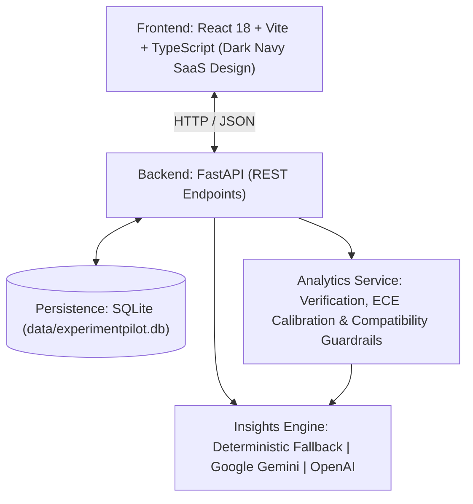

# ExperimentPilot: General-Purpose ML Experimentation & Model-Behavior Analysis

[](https://fastapi.tiangolo.com)
[](https://react.dev)
[](https://sqlite.org)
[](#testing--verification)

**ExperimentPilot** is a general-purpose, model-agnostic ML experimentation and model-behavior analysis platform. It empowers machine learning engineers and researchers to record experimental runs, verify metric integrity, perform controlled comparisons, diagnose sample-level prediction errors, and synthesize follow-up experiment proposals grounded in empirical evidence.

> [!NOTE]
> **Model-Agnostic Design Guarantee:**
> While multi-slice CT intracranial hemorrhage detection (`CoAtNet Consensus` vs `ConvNeXt-V2 Pool`) and credit risk tabular models are included as pre-seeded fixtures, **ExperimentPilot does not hardcode any architecture, modality, or domain**. It natively supports arbitrary classification, regression, and sequence tasks with arbitrary hyperparameter schemas and metric definitions.

---

## Key Features

1. **Flexible Experiment Management & Persistence**
   - Record runs with arbitrary task types (`classification`, `regression`, `multi_slice_classification`), model architectures, and dataset metadata.
   - Preserves arbitrary hyperparameter structures without schema truncation.
   - SQLite persistence with automated schema migrations.

2. **Independently Calculated Verification Metrics**
   - Distinguishes author-reported metrics from verified calculations derived directly from sample predictions.
   - Computes Accuracy, Precision, Recall, Macro-F1, Confusion Matrix, and 10-bin **Expected Calibration Error (ECE)** reliability curves.
   - Regression metrics: Mean Absolute Error (MAE), Mean Squared Error (MSE), Root Mean Squared Error (RMSE), and $R^2$ Score.

3. **Controlled Experiment Comparison**
   - Side-by-side metric delta computations with visual trade-off indicators.
   - Hyperparameter diff inspector highlighting controlled variables and confounding changes.
   - Scientific compatibility guardrails: Blocks misleading comparisons across mismatched datasets, splits, or task types.

4. **Model Behavior & Disagreement Explorer**
   - Filter sample populations by agreements, disagreements, false positives, and false negatives.
   - Modal scrubber: For multi-slice volumetric tasks, provides a 24-slice axial scrubber with slice-level activation heatmaps; for tabular/standard classification, renders clean feature and probability breakdowns.

5. **Hybrid AI Experiment Insights (Gemini + OpenAI + Deterministic)**
   - **Offline Deterministic ML Engine**: Evaluates metric trade-offs, calibration drift, and error distributions without requiring any API keys.
   - **Google Gemini & OpenAI Abstraction**: Optional LLM synthesis using server-side environment variables (`GEMINI_API_KEY`, `OPENAI_API_KEY`) or ephemeral client-side overrides.
   - **Standardized Taxonomy**: Classifies all findings into `Measured Observation`, `Rule-Derived Finding`, `Hypothesis`, and `Recommendation`.
   - **Evidence Grounding**: Every recommendation is explicitly linked to empirical evidence and can be promoted with one click into a persistent hypothesis.

6. **Validated Data Import & Export**
   - Versioned JSON Schema (`v1.0`) with validation.
   - CSV upload and text parsing for sample-level predictions and continuous targets.
   - Built-in ingestion guards: 5 MB payload limit and 10,000 sample row limit.

---

## Architecture Overview



---

## Directory Structure

```
BUIld_w_Ai/
├── scope.md                  # Project scope, constraints, and architecture boundaries
├── prd.md                    # Product Requirements Document
├── spec.md                   # Technical specification and API contract
├── .env.example              # Top-level environment template
├── README.md                 # Setup, architecture, and demonstration guide
├── backend/
│   ├── main.py               # FastAPI application and route handlers
│   ├── models.py             # Pydantic v2 schemas and data validation
│   ├── database.py           # SQLite persistence layer and migrations
│   ├── analytics.py          # Metric calculations, ECE curves, AI insights
│   ├── seed_data.py          # Synthetic benchmarks and test fixtures
│   ├── test_backend.py       # End-to-end backend test suite (9 suites)
│   ├── requirements.txt      # Python dependencies
│   ├── .env.example          # Backend secret configuration template
│   └── data/                 # SQLite database storage (experimentpilot.db)
└── frontend/
    ├── src/
    │   ├── App.tsx           # Navigation and top-level layout
    │   ├── api.ts            # Typed API client for FastAPI backend
    │   ├── types.ts          # TypeScript interfaces matching backend models
    │   ├── index.css         # Dark Navy design system with violet/cyan accents
    │   └── components/
    │       ├── OverviewView.tsx          # Experiment dashboard & stats
    │       ├── RunFactsView.tsx          # Configuration & verification metrics
    │       ├── ModelComparisonView.tsx   # Side-by-side comparison & ECE curves
    │       ├── BehaviorExplorerView.tsx  # Sample-level inspection & CT scrubber
    │       ├── AIInsightsView.tsx        # Evidence-grounded synthesis & LLM toggle
    │       ├── HypothesisDrawer.tsx      # Follow-up experiment planner
    │       ├── ImportExportModal.tsx     # JSON v1.0 and CSV ingestion interface
    │       └── CreateExperimentModal.tsx # New experiment creation with JSON params
    ├── vite.config.ts        # Vite build and proxy configuration
    └── package.json          # Frontend dependencies
```

---

## Quickstart & Setup

### Prerequisites
- Python 3.10+
- Node.js 18+ and npm

### 1. Backend Setup

```bash
# Navigate to backend directory
cd backend

# (Optional) Create and activate a virtual environment
python -m venv venv
venv\Scripts\activate  # Windows (or source venv/bin/activate on Unix)

# Install dependencies
pip install -r requirements.txt

# (Optional) Configure LLM API Keys
cp .env.example .env
# Edit backend/.env if you want to use Google Gemini or OpenAI:
# GEMINI_API_KEY="AIzaSy..."
# OPENAI_API_KEY="sk-..."

# Execute verification test suite
python test_backend.py

# Launch FastAPI development server
python -m uvicorn main:app --host 127.0.0.1 --port 8000 --reload
```

Backend will be available at `http://127.0.0.1:8000` (API documentation at `http://127.0.0.1:8000/docs`).

### 2. Frontend Setup

```bash
# In a new terminal, navigate to frontend directory
cd frontend

# Install npm dependencies
npm install

# Verify production build
npm run build

# Start frontend dev server
npm run dev
```

### 3. Root Workspace Commands (Convenience)

You can also run commands directly from the root workspace directory without switching folders:

```bash
# Start frontend dev server from root
npm run dev

# Build frontend from root
npm run build

# Run backend verification suite from root
npm run test:backend

# Or launch both Backend & Frontend in separate windows (Windows):
.\start_servers.bat
```


## Ingestion Formats

### 1. Versioned JSON (`v1.0`)

Upload or post to `/api/import`:

```json
{
  "version": "1.0",
  "experiment": {
    "name": "Custom XGBoost Tabular",
    "task_type": "classification",
    "model_family": "Gradient Boosted Trees",
    "architecture": "XGBoost-v2",
    "dataset_name": "CreditRisk-2026",
    "dataset_split": "Holdout Test",
    "dataset_size": "5,000 records",
    "evaluation_protocol": "Stratified 5-Fold CV",
    "hyperparameters": {
      "max_depth": 6,
      "learning_rate": 0.05,
      "subsample": 0.8,
      "custom_user_flag": "arbitrary_value_preserved"
    },
    "metrics": {
      "accuracy": 0.88,
      "f1_macro": 0.86
    },
    "samples": [
      {
        "case_id": "CASE-001",
        "true_label": 1,
        "predicted_label": 1,
        "probability": 0.89,
        "confidence": 0.89,
        "is_correct": true
      },
      {
        "case_id": "CASE-002",
        "true_label": 0,
        "predicted_label": 0,
        "probability": 0.12,
        "confidence": 0.88,
        "is_correct": true
      }
    ]
  }
}
```

### 2. CSV Sample Ingestion

Upload or post to `/api/import/csv`:

```csv
case_id,true_label,predicted_label,probability,confidence
CASE-A01,1,1,0.92,0.92
CASE-A02,0,0,0.05,0.95
CASE-A03,1,0,0.35,0.65
CASE-A04,0,1,0.78,0.78
```

For regression tasks:
```csv
case_id,continuous_true,continuous_prediction
CASE-R01,14.5,14.2
CASE-R02,28.0,29.1
CASE-R03,42.3,41.8
```

---

## Testing & Verification

The test suite validates database persistence, metric computation, compatibility guardrails, data ingestion, and LLM fallback resilience:

```bash
cd backend
python test_backend.py
```

### Verified Test Suites:
1. **Database Initialization & Seeding**: Verifies SQLite tables, schema migrations, and fixture seeding.
2. **Classification & ECE Calculations**: Tests Accuracy, Precision, Recall, Macro-F1, Confusion Matrix, and 10-bin calibration curves.
3. **Regression Calculations**: Tests MAE, MSE, RMSE, and $R^2$ score computations.
4. **Scientific Compatibility Guardrails**: Asserts that mismatched datasets or task types are properly blocked.
5. **Versioned JSON Import**: Validates schema `v1.0` ingestion and arbitrary hyperparameter preservation.
6. **CSV Import**: Validates CSV parsing, row/size limits, and error handling.
7. **Comparison & Disagreement Endpoints**: Verifies delta metric computations and error filtering.
8. **Deterministic ML Insights Engine**: Asserts offline synthesis generation without network dependencies.
9. **LLM Fallback Resilience**: Confirms graceful degradation to deterministic analysis when external API keys are missing or invalid.

---

## Deployment on Vercel

ExperimentPilot is pre-configured for one-click deployment on [Vercel](https://vercel.com) as a full-stack application (React + Vite static frontend with Python FastAPI Serverless Functions).

### Method 1: Deploy via Vercel Web Dashboard (Recommended)

1. Push your repository to GitHub:
   ```bash
   git add .
   git commit -m "Configure Vercel deployment"
   git push origin main
   ```
2. Navigate to [vercel.com/new](https://vercel.com/new) and log in.
3. Import the repository: `satyam-257/ExperimentPilotAI`.
4. Keep the default settings (Vercel automatically detects `vercel.json`, `outputDirectory: frontend/dist`, and Python runtime for `api/`).
5. (Optional) Set environment variables:
   - `GEMINI_API_KEY`: *(Optional)* For Google Gemini insights synthesis.
   - `OPENAI_API_KEY`: *(Optional)* For OpenAI insights synthesis.
6. Click **Deploy**.

### Method 2: Deploy via Vercel CLI

```bash
# 1. Install or run Vercel CLI
npx vercel

# 2. Deploy to production
npx vercel --prod
```

---

## Known Limitations

1. **Row & Payload Limits**: Standard file uploads are capped at 5 MB and 10,000 samples to guarantee sub-second browser rendering without pagination lags.
2. **Volumetric Slices**: The current slice scrubber supports pre-computed 2D axial representations. Future milestones will include client-side DICOM/NIfTI parsing via WebGL.
3. **LLM Hallucination Guard**: LLM synthesis is strictly bounded by deterministic evidence extracts passed in the system prompt; clinical diagnoses and unsupported causal claims are strictly suppressed.
