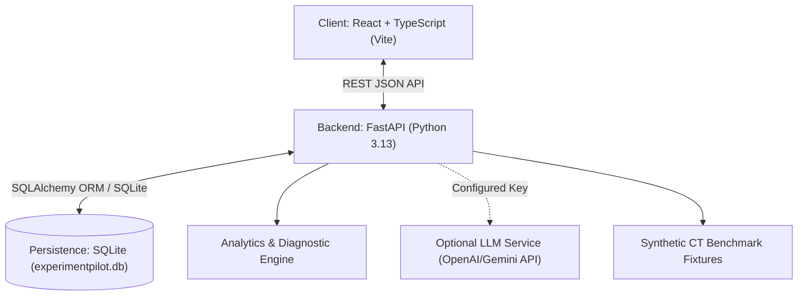

# ExperimentPilot: Technical Specification (Spec)

**Project Name:** ExperimentPilot  
**Version:** 1.0.0-MVP  
**Status:** Approved Technical Architecture  
**Stack:** React 19 / Vite / TypeScript + FastAPI / Python 3.13 / SQLite  

---

## 1. System Architecture



---

## 2. Backend Architecture & Data Models

### 2.1 Technology Stack
- **Framework:** FastAPI with Uvicorn async server.
- **Data Validation:** Pydantic v2 with strict typing.
- **Persistence:** SQLite database with JSON column serialization for flexible hyperparameter and sample-level data.
- **Analytics:** Modular Python statistics engine for agreement analysis, confusion matrices, confidence calibration, and deterministic rule generation.

### 2.2 Core Data Schemas

```python
# Experiment Schema (Model-Agnostic)
class ExperimentCreate(BaseModel):
    name: str
    task_type: Optional[str] = "classification" # "classification", "regression", "multi_slice_classification"
    model_family: str            # e.g., "Hybrid Transformer-CNN", "Pure ConvNet", "Transformer", "Ensemble", "Gradient Boosted Trees"
    architecture: str            # e.g., "CoAtNet-2", "ConvNeXt-V2-Base", "DINOv2-ViT", "XGBoost"
    aggregation_method: Optional[str] = "None" # e.g., "Consensus Voting (t=0.6)", "Max Pooling", "Mean Pooling", "None"
    dataset_name: str            # e.g., "RSNA-ICH-Synthetic-24Slice", "Tabular-Benchmark-v1"
    dataset_split: str           # e.g., "Validation Split A (n=200 scans)"
    dataset_size: str            # e.g., "200 scans (4,800 slices)", "10,000 tabular rows"
    evaluation_protocol: str     # e.g., "Patient-stratified 5-fold CV", "Holdout 80/20 Test"
    git_branch: Optional[str] = "main"
    git_commit: Optional[str] = "a7e891c"
    jira_owner: Optional[str] = "ML-Research"
    hyperparameters: Dict[str, Any] = Field(default_factory=dict) # Arbitrary key-value pairs preserved
    preprocessing: Dict[str, Any] = Field(default_factory=dict)
    metrics: Dict[str, float] = Field(default_factory=dict)    # User-reported imported metrics
    calculated_metrics: Optional[Dict[str, float]] = None      # Independently computed verification metrics (ECE, accuracy, per-class F1)
    loss_history: List[float] = Field(default_factory=list)    # Epoch or step loss curve
    confusion_matrix: Dict[str, Any] = Field(default_factory=dict) # {"tn": 105, "fp": 15, "fn": 8, "tp": 72}
    calibration_curve: Optional[List[Dict[str, float]]] = None # Binned reliability diagram data [{"bin_center": 0.1, "accuracy": 0.08, "confidence": 0.09, "count": 25}]
    feature_importance: Optional[List[Dict[str, Any]]] = None # Slice/Feature weights
    notes: Optional[str] = ""
    is_synthetic: bool = False

# Versioned Import Format (v1.0)
class VersionedExperimentImport(BaseModel):
    version: str = "1.0"
    experiment: ExperimentCreate

# Case / Sample Prediction Schema
class SlicePrediction(BaseModel):
    slice_index: int             # 0 to N-1
    probability: float          # Focal lesion probability on this slice
    predicted_label: int
    is_focal_ground_truth: bool

class CaseSample(BaseModel):
    case_id: str                # e.g., "SCAN-2041"
    experiment_id: str
    true_label: int             # 0 = Negative, 1 = Positive (e.g. Hemorrhage)
    predicted_label: int
    probability: float
    is_correct: bool
    confidence: float
    slices: Optional[List[SlicePrediction]] = None
    finding_type: Optional[str] = "Intracranial Hemorrhage"
    slice_count: Optional[int] = 24

# Hypothesis Schema
class Hypothesis(BaseModel):
    id: str
    experiment_id: Optional[str] = None
    title: str
    rationale: str
    status: str                 # "Draft", "In Progress", "Validated", "Rejected"
    created_at: str
    tags: List[str]
```

---

## 3. Frontend Architecture

### 3.1 Technology Stack
- **Bundler:** Vite
- **UI Framework:** React 19 + TypeScript
- **Styling:** Custom Tailwind CSS v3 / Vanilla CSS tokens replicating dark navy reference mockup:
  - Deep Navy Canvas (`#080d1a`)
  - Glass Card Panes (`#101c38`)
  - Accent Violet (`#8b5cf6`), Cyan (`#06b6d4`), Mint (`#10b981`), Warning Coral (`#f43f5e`)
- **Icons:** `lucide-react`
- **Charts:** Custom responsive SVG sparklines, loss curves, calibration diagrams, and confusion matrix heatmaps.

### 3.2 UI Component Breakdown
1. **App Layout (`App.tsx`):**
   - Left Navigation Rail: Workspace logo, Overview, Experiment Manager, Model Comparison, Behavior Explorer, AI Insights, Add button, Settings, Profile avatar.
   - Dynamic Main Workspace with view routing and persistent state.
2. **Overview Section (`OverviewView.tsx`):**
   - Summary stat cards (Total runs, Best experiment, Top F1, Disagreement rate).
   - Recent activity list.
   - Quick launch for comparing CoAtNet Consensus vs ConvNeXt-V2 Pool.
3. **Experiment Manager Section (`ExperimentManagerView.tsx`):**
   - Header tabs: `[Run Facts]`, `[Demo Space]`, `[Analysis]`.
   - General Metadata Card (badges for Owner, Git Branch, Commit).
   - Model Metadata Card (Algorithm, Hyperparameters pills).
   - Data Metadata Card (Dataset name, Preprocessing, Size, Observations).
   - Metrics Card (Loss curve with -5.2% delta, Explainability / Slice importance, Confusion Matrix with active warning callout).
   - Hypothesis Flow timeline drawer on left.
   - Action Button: "Create Hypothesis".
4. **Model Comparison Section (`ModelComparisonView.tsx`):**
   - Model Selector dropdowns (Select Run A and Run B).
   - Protocol Compatibility Banner (warns if datasets or splits do not match).
   - Metrics Diff Grid (Accuracy, F1, Loss, Latency with delta chips).
   - Side-by-side Confusion Matrices and Confidence Histograms.
   - Hyperparameter & Configuration Diff Table.
5. **Model Behavior Explorer (`ModelBehaviorExplorerView.tsx`):**
   - Signature feature: Scan & slice-level inspector.
   - Agreement / Disagreement segmentation filter tabs:
     - `[All Cases (200)]`
     - `[Mutual Agreement - Correct (162)]`
     - `[Disagreement Cases (22)]`
     - `[Both In Error (16)]`
     - `[Model A Only Correct (14)]`
     - `[Model B Only Correct (8)]`
   - Case Detail Modal / Panel:
     - Interactive axial CT slice scrubber (24 slices).
     - Slice focal lesion probability curve showing exactly where Model A and Model B diverged.
     - Explanation of Consensus Quorum vs Max/Mean Pooling behavior.
6. **AI Experiment Insights (`AIInsightsView.tsx`):**
   - Toggle: Provider-independent LLM mode (API key entry for OpenAI / Gemini) vs Embedded Deterministic ML Engine mode.
   - Structured Findings: Discrepancy analysis, error risk breakdown, controlled follow-up proposals.
   - One-click "Promote to Hypothesis" button that syncs directly with the hypothesis timeline.

---

## 4. REST API Endpoint Specifications

| Endpoint | Method | Description |
|---|---|---|
| `/api/experiments` | GET | List all experiment runs |
| `/api/experiments` | POST | Create a new experiment |
| `/api/experiments/{id}` | GET | Fetch single experiment with full metadata |
| `/api/experiments/{id}` | PUT | Update experiment notes or metadata |
| `/api/experiments/{id}` | DELETE | Remove an experiment record |
| `/api/compare` | POST | Compute comparative metrics & compatibility between two experiment IDs |
| `/api/explorer/cases` | GET | Query sample & slice prediction records with agreement filters |
| `/api/insights/generate` | POST | Generate grounded AI / deterministic analysis report |
| `/api/hypotheses` | GET | List recorded hypotheses |
| `/api/hypotheses` | POST | Create a new hypothesis card |
| `/api/hypotheses/{id}` | PATCH | Update hypothesis status or notes |
| `/api/seed` | POST | Seed synthetic CoAtNet Consensus and ConvNeXt-V2 Pool benchmark data |
| `/api/import` | POST | Import structured versioned JSON experiment record |
| `/api/import/csv` | POST | Ingest experiment results and sample predictions via CSV upload |
| `/api/export/{id}` | GET | Export experiment record as JSON |

---

## 5. Verification & Testing Plan

1. **Backend Integration Tests:**
   - Test CRUD endpoints on SQLite.
   - Test compatibility guardrail on mismatched dataset names.
   - Test deterministic ML diagnostic engine output format.
2. **Frontend Build Verification:**
   - Run `npm run build` with TypeScript zero-error check.
3. **End-to-End Workflow Verification via Browser Agent:**
   - Launch Vite frontend and FastAPI backend.
   - Open browser, navigate through Overview -> Experiment Manager -> Model Comparison -> Behavior Explorer -> AI Insights.
   - Verify interactive slice scrubber on a disagreement case.
   - Verify "Create Hypothesis" flow and timeline persistence.
   - Confirm dark navy aesthetic faithfully matches the reference mockup.
